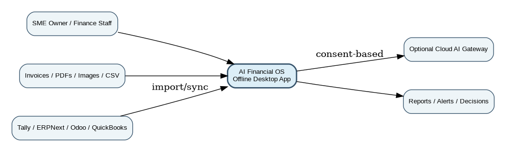
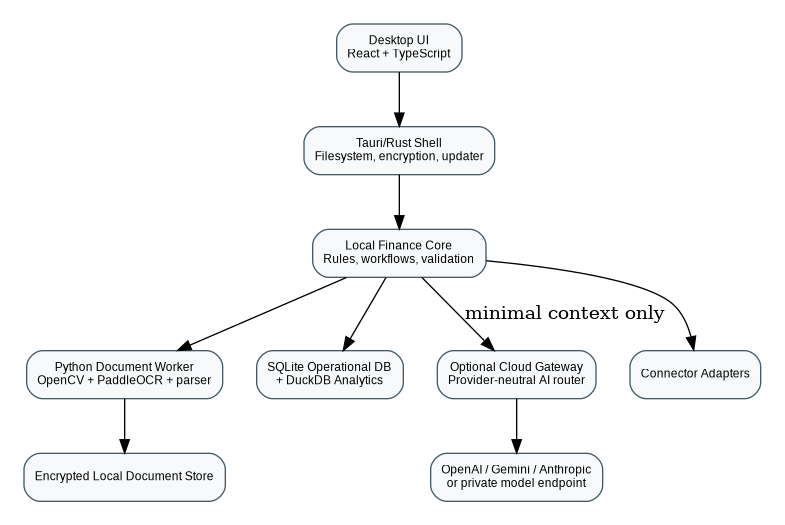
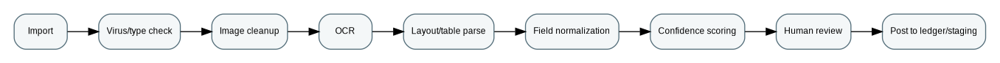
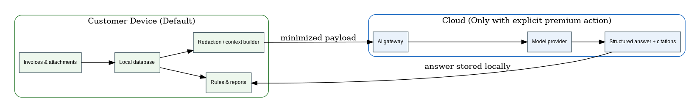

# AI Financial Operating System for SMEs

## Product Requirements Document and Technical Blueprint



**Version 1.0 \| 3 August 2026**

*Prepared as a product-owner reference and an implementation handoff for
OpenAI Codex.*

| **Status:** Developer-ready planning baseline. This is not legal, tax, accounting, or licensing advice. Validate jurisdiction-specific requirements and all third-party licenses before commercial release. |
|-------------------------------------------------------------------------------------------------------------------------------------------------------------------------------------------------------------|

# Document Control

| **Field**                       | **Decision**                                                                                             |
|---------------------------------|----------------------------------------------------------------------------------------------------------|
| Document owner                  | Product founder / product owner                                                                          |
| Primary implementation audience | OpenAI Codex, lead engineer, solution architect, QA lead                                                 |
| Product working name            | AI Financial Operating System (AIFOS); rename before public launch                                       |
| Initial market                  | English-language SMEs; India pilot recommended, followed by UAE and selected export markets              |
| Primary platform                | Windows desktop, offline-first                                                                           |
| Commercial model                | Freemium local core plus optional paid cloud AI decision-support services                                |
| Architecture status             | Recommended reference architecture; subject to prototype benchmarks and legal review                     |
| Explicitly deferred             | Blockchain, autonomous payments, full ERP replacement, perfect handwriting recognition, all-language OCR |

## Change Log

| **Version** | **Date**         | **Summary**                                                                                                                              |
|-------------|------------------|------------------------------------------------------------------------------------------------------------------------------------------|
| 0.1         | Prior discussion | Initial concept: offline OCR, reports, optional AI CFO.                                                                                  |
| 1.0         | 3 Aug 2026       | Full PRD, open-source base strategy, licensing decision gate, architecture, requirements, acceptance criteria, and Codex execution plan. |

## How to Use This Document

- **For the founder:** Use Sections 1–9 to validate the product and
  commercial assumptions before development.

- **For Codex:** Use Sections 10–26 as binding implementation
  requirements. Work milestone-by-milestone; do not build deferred
  features.

- **For engineers:** Treat requirement IDs and acceptance criteria as
  the source of truth. Record deviations in an Architecture Decision
  Record (ADR).

- **For legal/accounting review:** Focus on licensing, privacy, AI
  disclosures, tax-localization boundaries, and data-processing
  agreements.

- **For pilots:** Use the success metrics, usability criteria, and pilot
  plan to evaluate whether the product saves measurable time or prevents
  errors.

# 1. Executive Summary

AIFOS is an offline-first desktop application that converts invoices and
finance records into a clean, searchable operating view for small and
medium-sized businesses. The local product provides document ingestion,
English OCR, field extraction, human review, deterministic finance
rules, dashboards, alerts, and configurable reports without requiring an
internet connection. A paid cloud layer adds conversational analysis,
cash-flow scenarios, decision support, and narrative reports through a
provider-neutral large-language-model gateway.

The product must not attempt to replace a regulated accountant,
independently file taxes, move money, or make irreversible financial
decisions. It is an intelligence and workflow layer that improves the
quality, speed, and explainability of finance operations while keeping
the human owner or accountant in control.



Figure 1 — Recommended reference architecture

## 1.1 Executive Product Decisions

| **ID** | **Decision**                                                        | **Rationale**                                                                                                                 |
|--------|---------------------------------------------------------------------|-------------------------------------------------------------------------------------------------------------------------------|
| ED-01  | Build a lightweight offline desktop product first.                  | Target hardware and privacy needs make a browser-only ERP unsuitable as the primary experience.                               |
| ED-02  | No local 8B LLM in MVP.                                             | Most target PCs lack RAM/GPU capacity; deterministic rules and OCR create most of the early value.                            |
| ED-03  | Use cloud AI only after explicit user action.                       | Keeps the base product usable offline and makes privacy boundaries understandable.                                            |
| ED-04  | Do not build a complete accounting ledger initially.                | Import from existing systems or maintain a staging/subledger sufficient for intelligence and reports.                         |
| ED-05  | Blockchain is deferred.                                             | It adds no essential value to the first single-company invoice workflow.                                                      |
| ED-06  | Choose the open-source base only after a license strategy decision. | Frappe Books is the fastest open-core route but is AGPL-3.0; a permissive custom core offers greater proprietary flexibility. |
| ED-07  | English printed invoices first.                                     | Handwriting and multiple languages are later capabilities driven by pilot demand.                                             |
| ED-08  | Every recommendation must be explainable.                           | The user must see the data, assumptions, and rules supporting an alert or AI answer.                                          |

## 1.2 Recommended Base Strategy

| **Recommended commercial architecture:** Build the proprietary/lightweight desktop core with Tauri, React/TypeScript, SQLite, DuckDB, and a separate Python OCR worker. Integrate with ERPNext, Odoo, Tally, QuickBooks, and Frappe Books through adapters instead of embedding their full codebases. |
|-------------------------------------------------------------------------------------------------------------------------------------------------------------------------------------------------------------------------------------------------------------------------------------------------------|

For a rapid market-validation prototype, a separate branch may fork
Frappe Books. That route can save significant UI and accounting
groundwork, but the modified desktop application must be managed under
the requirements of its AGPL-3.0 license. The cloud AI service should
remain a cleanly separated service with an independently reviewed
interface. Obtain specialist open-source counsel before choosing that
route for a commercial product.

# 2. Product Definition

## 2.1 Vision

Give every SME a privacy-conscious finance operations assistant that
turns messy documents and disconnected records into timely,
understandable, and actionable information—without forcing the business
to replace the tools it already trusts.

## 2.2 Product Promise

- Import invoices in minutes, not hours.

- See what is due, unusual, missing, duplicated, or becoming risky.

- Generate useful reports offline.

- Ask deeper finance questions only when the user chooses cloud AI.

- Keep source documents, extracted fields, and corrections auditable.

- Work alongside accountants and existing accounting software rather
  than claiming to replace them.

## 2.3 Problem Statement

Many SMEs receive invoices through email, WhatsApp, paper, scanners,
supplier portals, and accounting exports. Staff manually read them,
rename files, retype fields, reconcile totals, decide which supplier to
pay, and prepare recurring reports. Traditional accounting applications
are systems of record; they often do not provide a unified
document-intelligence and decision-support layer across these
unstructured inputs. The result is clerical effort, delayed visibility,
duplicate or incorrect entries, missed due dates, and decisions based on
incomplete data.

## 2.4 Jobs to Be Done

| **ID**  | **Job**                                                                                                                          |
|---------|----------------------------------------------------------------------------------------------------------------------------------|
| JTBD-01 | When invoices arrive in mixed formats, I want them captured and organized automatically so that staff do not retype every field. |
| JTBD-02 | When cash is limited, I want a transparent priority view so that I understand which obligations are urgent and why.              |
| JTBD-03 | When a supplier changes prices, I want an early alert so that I can negotiate or source alternatives.                            |
| JTBD-04 | When my accountant asks for records, I want a complete, traceable package so that audit preparation is faster.                   |
| JTBD-05 | When I review performance, I want customized reports in my business language so that the numbers lead to decisions.              |
| JTBD-06 | When I ask a complex question, I want an AI answer grounded in my own transactions, with citations and assumptions.              |
| JTBD-07 | When the internet is unavailable or sensitive data must stay local, I want the core product to continue working.                 |

# 3. Target Users and Markets

## 3.1 Primary Personas

| **Persona**                   | **Context**                                | **Pain**                                                              | **Primary value**                                     |
|-------------------------------|--------------------------------------------|-----------------------------------------------------------------------|-------------------------------------------------------|
| Owner-manager                 | 10–100 employee manufacturer/trader        | Cash position, overdue receivables, supplier dues, margin changes     | Dashboard, priority list, plain-language reports      |
| Finance executive             | Processes documents and reconciles entries | Manual typing, duplicate invoices, missing fields, month-end pressure | OCR queue, validation, exports, exception handling    |
| Accountant / advisor          | Reviews books and compliance               | Inconsistent source documents, unclear audit trail                    | Reviewer access, correction history, standard reports |
| Operations / purchase manager | Controls suppliers and materials           | Price drift, quantity mismatch, delivery/invoice differences          | Supplier trends, PO/GRN matching later                |
| External auditor / consultant | Needs evidence without editing data        | Time-consuming document requests                                      | Read-only audit pack and evidence links               |

## 3.2 Market Sequence

| **Stage**   | **Market**                | **Scope**                                                                                               |
|-------------|---------------------------|---------------------------------------------------------------------------------------------------------|
| Pilot       | India, English-first SMEs | Manufacturing/trading businesses already using Tally, spreadsheets, or PDFs.                            |
| Expansion 1 | UAE SMEs                  | English and Arabic document roadmap; VAT-oriented reports; privacy and data-hosting review.             |
| Expansion 2 | US/Europe niche verticals | QuickBooks/Xero connectors, jurisdiction packs, GDPR/privacy requirements, industry-specific workflows. |

| **Market discipline:** Do not launch globally with generic claims. Prove one vertical and one workflow: invoice ingestion → review → due-date/price alerts → offline management report. |
|-----------------------------------------------------------------------------------------------------------------------------------------------------------------------------------------|

# 4. Product Principles, Scope, and Boundaries

## 4.1 Product Principles

- **Offline by default:** No login or internet connection should be
  required for core document and report workflows.

- **Human-verifiable intelligence:** Every extracted value and
  recommendation links to source evidence.

- **Rules before generative AI:** Use deterministic calculations for
  totals, aging, thresholds, and compliance dates.

- **Progressive enhancement:** Cloud AI adds value but does not hold the
  base product hostage.

- **Integration over replacement:** Read from and export to existing
  accounting/ERP systems.

- **Low-end hardware awareness:** Avoid background model processes and
  excessive memory use.

- **Safe failure:** Low-confidence documents go to review; the system
  never silently invents financial facts.

- **Modular architecture:** OCR engines, model providers, and ERP
  connectors must be replaceable.

## 4.2 MVP In Scope

- Windows desktop installer and local company workspace.

- English printed invoice import from PDF, JPG, PNG, and folder watch.

- Local OCR, extraction, confidence scoring, and review queue.

- Vendor/customer master and invoice staging records.

- Duplicate detection, price-change alerts, due-date alerts, aging,
  basic anomaly rules.

- Offline dashboards and configurable reports.

- CSV/Excel-compatible import/export and PDF report export.

- Optional cloud AI analysis with explicit consent and grounded answers.

- Encrypted local backups and restore.

- Basic ERP connector framework; one pilot connector selected after
  discovery.

## 4.3 Explicitly Out of Scope for MVP

- Full double-entry accounting replacement or statutory books of
  account.

- Automated tax filing, audit opinion, or legal/accounting advice.

- Autonomous bank payments or payment initiation.

- Perfect handwriting recognition.

- All Indian languages, Arabic, or global tax-localization on day one.

- Blockchain-based invoice transfer, tokens, cryptocurrency, or smart
  contracts.

- Payroll, CRM, manufacturing planning, and full inventory ERP.

- Continuous cloud synchronization of all raw documents.

- Fully autonomous AI agents negotiating or committing to supplier
  terms.

# 5. Open-Source Base Platform Decision

## 5.1 Decision Gate

Before Codex writes production code, the founder must choose one of the
following license strategies. This is a commercial and legal decision,
not only a technical one.

| **Option**                              | **Base**                                     | **Advantages / constraints**                                                         | **Use when**                                      |
|-----------------------------------------|----------------------------------------------|--------------------------------------------------------------------------------------|---------------------------------------------------|
| A. Custom permissive core (recommended) | Tauri + React + SQLite + DuckDB + Python OCR | More initial development; maximum control; lightweight; easier proprietary licensing | Best for long-term commercial product             |
| B. Frappe Books fork                    | Fork existing offline accounting desktop app | Fastest prototype; substantial accounting/UI base; AGPL-3.0 obligations              | Best only if open-core distribution is acceptable |
| C. ERPNext/Frappe web app               | Build an ERPNext app or external integration | Rich ERP; server-heavy; ERPNext GPL-3.0; not ideal for old offline PCs               | Best for enterprise/web pilots                    |
| D. Odoo Community module                | Add intelligence as Odoo modules/services    | Large ecosystem; web/server deployment; LGPL core with edition/module complexity     | Best when customer already uses Odoo              |

## 5.2 Recommended Decision

Use Option A for the production architecture. Build a narrow desktop
intelligence product rather than a full ledger. Use Frappe Books as a
reference implementation and optional import target. Run a time-boxed
Option B prototype only if the team accepts an open-core licensing model
and receives legal approval.

## 5.3 Why Frappe Books Matters

Frappe Books is the most directly relevant open-source base discovered
for this concept: it is an offline desktop accounting application using
Electron, Vue, and SQLite, with invoicing, payments, double-entry
accounting, dashboards, and financial reports. Its repository includes
development and build instructions. However, it is licensed under
AGPL-3.0, so a commercial fork must be planned around source-disclosure
and distribution obligations. \[OS-01\]

## 5.4 License Rules for the Project

- Create a THIRD_PARTY_NOTICES.md and software bill of materials (SBOM)
  from the first commit.

- Pin dependency versions and preserve copyright/license notices.

- Do not copy source code from GPL/AGPL projects into a proprietary core
  without approved legal strategy.

- Keep GPL/AGPL integrations process-separated or API-based where
  practical, but do not assume separation automatically removes
  obligations.

- Check transitive dependencies; a permissive top-level license does not
  guarantee every optional dependency is suitable.

- Have counsel review model-weight licenses independently from
  inference-runtime licenses.

- Document every fork, patch, and upstream commit hash used.

# 6. Verified Open-Source Components and Download Instructions

The following list was checked against official repositories on 3 August
2026. “Recommended” means technically suitable for evaluation, not a
legal approval.

| **ID** | **Project**             | **Role**                               | **License**                                                        | **Official repository**                    | **Start command**                                                   |
|--------|-------------------------|----------------------------------------|--------------------------------------------------------------------|--------------------------------------------|---------------------------------------------------------------------|
| OS-01  | Frappe Books            | Optional rapid prototype/reference     | AGPL-3.0                                                           | https://github.com/frappe/books            | git clone https://github.com/frappe/books.git                       |
| OS-02  | ERPNext                 | ERP integration/reference              | GPL-3.0                                                            | https://github.com/frappe/erpnext          | git clone https://github.com/frappe/erpnext.git                     |
| OS-03  | Frappe Framework        | Optional web/admin framework           | MIT                                                                | https://github.com/frappe/frappe           | git clone https://github.com/frappe/frappe.git                      |
| OS-04  | Odoo Community          | Optional ERP integration               | LGPL-3.0                                                           | https://github.com/odoo/odoo               | git clone --branch 19.0 https://github.com/odoo/odoo.git            |
| OS-05  | Tauri                   | Recommended desktop shell              | MIT / Apache-2.0                                                   | https://github.com/tauri-apps/tauri        | npm create tauri-app@latest                                         |
| OS-06  | PaddleOCR               | Primary OCR candidate                  | Apache-2.0                                                         | https://github.com/PaddlePaddle/PaddleOCR  | pip install paddleocr                                               |
| OS-07  | Tesseract               | OCR fallback/benchmark                 | Apache-2.0                                                         | https://github.com/tesseract-ocr/tesseract | Install OS package; keep language files versioned                   |
| OS-08  | Docling                 | Document parsing benchmark             | MIT (models vary)                                                  | https://github.com/docling-project/docling | pip install docling                                                 |
| OS-09  | SQLite                  | Operational local database             | Public domain                                                      | https://sqlite.org/                        | Bundled through application library                                 |
| OS-10  | DuckDB                  | Local analytics engine                 | MIT                                                                | https://github.com/duckdb/duckdb           | Use official binding; pin version                                   |
| OS-11  | Apache ECharts          | Dashboard visualizations               | Apache-2.0                                                         | https://github.com/apache/echarts          | npm install echarts                                                 |
| OS-12  | Ollama                  | Optional developer/local-model runtime | Runtime/repo license must be rechecked; model licenses vary        | https://github.com/ollama/ollama           | Use only in advanced/dev mode; not MVP dependency                   |
| OS-13  | Qwen open-weight models | Optional future local/cloud model      | Model-specific; current Qwen3 open weights described as Apache-2.0 | https://github.com/QwenLM/Qwen3            | Do not bundle until model license and hardware profile are approved |
| OS-14  | LangChain               | Optional provider/tool adapter         | MIT                                                                | https://github.com/langchain-ai/langchain  | Prefer thin internal adapters; add only if it reduces code          |
| OS-15  | LlamaIndex              | Optional document/RAG framework        | MIT                                                                | https://github.com/run-llama/llama_index   | Use selectively; avoid unnecessary abstraction                      |
| OS-16  | Qdrant                  | Future vector search service           | Apache-2.0                                                         | https://github.com/qdrant/qdrant           | Not required for MVP; SQLite FTS may suffice                        |
| OS-17  | Chroma                  | Prototype vector store                 | Apache-2.0                                                         | https://github.com/chroma-core/chroma      | Prototype only; not required for core                               |

## 6.1 Frappe Books Evaluation Commands

git clone https://github.com/frappe/books.git

cd books

\# Follow the repository's current Node.js prerequisite

\# Install the package manager specified by the repo

\# Then:

yarn

yarn dev

\# Build installer:

yarn build

| **Do not begin by modifying the fork:** First run the unmodified application, map its data model and extension points, and document which modules would be reused. Make the license decision before committing proprietary business logic to the fork. |
|--------------------------------------------------------------------------------------------------------------------------------------------------------------------------------------------------------------------------------------------------------|

## 6.2 Recommended New Project Scaffold

\# Desktop shell

npm create tauri-app@latest aifos-desktop

\# Suggested choices

\# Frontend: React + TypeScript + Vite

\# Package manager: pnpm

cd aifos-desktop

pnpm install

pnpm tauri dev

\# Separate Python document worker

python -m venv .venv

\# Windows: .venv\Scripts\activate

pip install fastapi uvicorn pydantic pillow opencv-python-headless
paddleocr

# 7. Core User Journeys

## UJ-01 First-time setup

1.  Install desktop app.

2.  Create local company workspace.

3.  Choose currency, financial year, and date format.

4.  Set local backup location.

5.  Optionally import vendors/customers and historical invoices.

6.  No cloud account is required for the free offline mode.

## UJ-02 Import and review invoice

7.  Drag files, scan, or monitor an import folder.

8.  System validates file type and creates immutable source hash.

9.  OCR and parsing run locally.

10. User sees extracted fields beside source image.

11. Low-confidence fields are highlighted.

12. User corrects and approves.

13. Approved record enters staging and analytics.

## UJ-03 Monitor obligations

14. Dashboard groups overdue, due soon, and later obligations.

15. Rule engine calculates urgency and penalties from entered terms.

16. User can filter by supplier, amount, date, category, and confidence.

17. No payment is executed by the system.

## UJ-04 Create an offline report

18. Choose template, date range, filters, and grouping.

19. Preview tables and charts.

20. Add/remove sections.

21. Export PDF/CSV without internet.

## UJ-05 Ask cloud AI

22. User presses Ask AI on a report or dashboard.

23. System displays what data will leave the device.

24. User confirms.

25. Context builder selects and redacts minimum necessary data.

26. AI returns an answer with transaction/report citations and
    assumptions.

27. User can save the answer locally or discard it.

## UJ-06 Accountant review

28. Owner exports an audit pack or creates read-only local reviewer
    access.

29. Reviewer sees source document, extracted values, corrections, and
    rule events.

30. Corrections are logged with timestamp and user.

# 8. Functional Requirements

## 8.1 Workspace, Identity, and Onboarding

| **ID**     | **Priority** | **Requirement**                                                                                | **Acceptance**                                                                                 |
|------------|--------------|------------------------------------------------------------------------------------------------|------------------------------------------------------------------------------------------------|
| FR-ONB-001 | Must         | Create one or more local company workspaces with independent databases and document stores.    | A user can create, open, rename, back up, and restore a company without internet.              |
| FR-ONB-002 | Must         | Allow optional local PIN/password protection and OS-keychain integration.                      | The workspace cannot be opened without the configured credential; recovery warnings are clear. |
| FR-ONB-003 | Must         | Configure base currency, locale, date format, financial year, tax labels, and report branding. | Settings are reflected in dashboards and exports.                                              |
| FR-ONB-004 | Should       | Import vendor/customer masters from CSV.                                                       | Validation errors are reported per row and do not block valid rows.                            |
| FR-ONB-005 | Should       | Create role profiles: Owner, Finance Operator, Reviewer.                                       | Permissions are enforced locally and included in the audit log.                                |

## 8.2 Document Ingestion

| **ID**     | **Priority** | **Requirement**                                                                                | **Acceptance**                                                                   |
|------------|--------------|------------------------------------------------------------------------------------------------|----------------------------------------------------------------------------------|
| FR-ING-001 | Must         | Import PDF, JPG, JPEG, PNG, and supported image-based scans through drag/drop and file picker. | Each file receives an import ID, SHA-256 hash, original filename, and timestamp. |
| FR-ING-002 | Must         | Support batch import with progress, pause, resume, and per-file failure status.                | One malformed file does not fail the batch.                                      |
| FR-ING-003 | Must         | Provide a configurable watched folder.                                                         | New files are copied into the managed store only after stable-size checks.       |
| FR-ING-004 | Must         | Detect exact duplicate files by hash and probable duplicate invoices by normalized fields.     | User can keep, link, or reject duplicates.                                       |
| FR-ING-005 | Should       | Import structured CSV exports from existing accounting systems.                                | Mapping templates can be saved and reused.                                       |
| FR-ING-006 | Could        | Capture documents from email or mobile companion.                                              | Deferred until cloud/privacy model is validated.                                 |

## 8.3 OCR and Document Understanding

| **ID**     | **Priority** | **Requirement**                                                                                                                                                                        | **Acceptance**                                                           |
|------------|--------------|----------------------------------------------------------------------------------------------------------------------------------------------------------------------------------------|--------------------------------------------------------------------------|
| FR-OCR-001 | Must         | Preprocess images locally: orientation, deskew, denoise, contrast, crop, and page segmentation.                                                                                        | The original is preserved; processed derivatives are reproducible.       |
| FR-OCR-002 | Must         | Run English printed-text OCR locally without a GPU.                                                                                                                                    | OCR works on the minimum supported PC within the performance budget.     |
| FR-OCR-003 | Must         | Extract invoice number, invoice date, supplier, tax identifier, currency, subtotal, tax, total, due date, payment terms, line items when reliable, and bank details as untrusted text. | Every field includes confidence and source coordinates.                  |
| FR-OCR-004 | Must         | Show side-by-side source and extracted fields with click-to-highlight bounding boxes.                                                                                                  | A user can verify where every value came from.                           |
| FR-OCR-005 | Must         | Route low-confidence or mathematically inconsistent documents to review.                                                                                                               | No low-confidence record is auto-approved.                               |
| FR-OCR-006 | Must         | Validate totals: subtotal + tax ± adjustments = total within configurable tolerance.                                                                                                   | Inconsistencies generate an explicit exception.                          |
| FR-OCR-007 | Should       | Learn reusable supplier templates from confirmed documents without training a general model.                                                                                           | Template rules are editable and reversible.                              |
| FR-OCR-008 | Could        | Add Hindi/Gujarati/Arabic printed OCR packs.                                                                                                                                           | Only after language-specific benchmark corpus and customer demand exist. |
| FR-OCR-009 | Won’t MVP    | Guarantee handwriting recognition.                                                                                                                                                     | Handwritten documents are marked unsupported or sent to manual entry.    |



Figure 2 — Local OCR and review pipeline

## 8.4 Review and Correction Workflow

| **ID**     | **Priority** | **Requirement**                                                                      | **Acceptance**                                                            |
|------------|--------------|--------------------------------------------------------------------------------------|---------------------------------------------------------------------------|
| FR-REV-001 | Must         | Maintain statuses: Imported, Processing, Needs Review, Approved, Rejected, Exported. | Status transitions follow a documented state machine.                     |
| FR-REV-002 | Must         | Record original OCR value, corrected value, user, time, and reason.                  | Audit history is immutable through the UI.                                |
| FR-REV-003 | Must         | Support keyboard-first review for high-volume operators.                             | A trained user can validate common fields without mouse-only interaction. |
| FR-REV-004 | Should       | Surface repeated correction patterns and propose a vendor template update.           | Proposal requires user approval and has a rollback option.                |
| FR-REV-005 | Should       | Allow comments and internal tags.                                                    | Comments do not modify accounting values.                                 |

## 8.5 Vendor, Customer, and Category Intelligence

| **ID**     | **Priority** | **Requirement**                                                                                        | **Acceptance**                                                                       |
|------------|--------------|--------------------------------------------------------------------------------------------------------|--------------------------------------------------------------------------------------|
| FR-MST-001 | Must         | Maintain normalized vendor/customer records with aliases and identifiers.                              | Duplicate entities can be merged with a reversible audit event.                      |
| FR-MST-002 | Must         | Show invoice count, spend/revenue, average payment terms, price trends, and exception rate per entity. | Metrics reconcile to approved records.                                               |
| FR-MST-003 | Should       | Classify invoices and line items into editable categories.                                             | User corrections take priority over automated suggestions.                           |
| FR-MST-004 | Should       | Flag new or changed bank details for manual verification.                                              | The product never treats OCR-extracted bank details as trusted payment instructions. |
| FR-MST-005 | Could        | Calculate supplier reliability using delivery/PO data.                                                 | Requires future PO/GRN integration.                                                  |

## 8.6 Offline Rule Engine

| **Rule ID** | **Name**                   | **Logic**                                                                                        | **Output**                               |
|-------------|----------------------------|--------------------------------------------------------------------------------------------------|------------------------------------------|
| RULE-001    | Exact duplicate file       | Same content hash                                                                                | Block or link import                     |
| RULE-002    | Probable duplicate invoice | Same normalized vendor + invoice number; or high similarity amount/date                          | Review alert                             |
| RULE-003    | Arithmetic mismatch        | Extracted components do not reconcile to total                                                   | Needs Review                             |
| RULE-004    | Price increase             | Unit price or normalized invoice category increases above configurable threshold versus baseline | Dashboard alert                          |
| RULE-005    | Due soon                   | Due date within configured window                                                                | Priority queue                           |
| RULE-006    | Overdue                    | Due date passed and unpaid/uncleared                                                             | Escalated alert                          |
| RULE-007    | Penalty exposure           | Payment terms include structured late fee entered/confirmed by user                              | Estimated cost with assumptions          |
| RULE-008    | Unusual amount             | Amount outside configurable historical range                                                     | Review alert                             |
| RULE-009    | New bank details           | Bank field differs from confirmed vendor master                                                  | High-severity manual verification        |
| RULE-010    | Missing tax identifier     | Required field missing under selected jurisdiction pack                                          | Compliance warning, not legal conclusion |
| RULE-011    | Cash gap                   | Projected obligations exceed entered available cash in a future bucket                           | Scenario warning                         |
| RULE-012    | Concentration risk         | Spend or receivable exposure to one party exceeds threshold                                      | Management alert                         |

## 8.7 Payment Priority View

The payment priority view is a decision-support queue, not an autonomous
payment system. It must use explicit factors and allow the owner to
override them.

| **Factor**                 | **Definition**                             | **Illustrative weight** |
|----------------------------|--------------------------------------------|-------------------------|
| Due date urgency           | Days until/past due                        | 0–30                    |
| Confirmed penalty/interest | Cost of delay based on entered terms       | 0–20                    |
| Operational criticality    | User-defined supplier/category criticality | 0–20                    |
| Discount opportunity       | Confirmed early-payment discount           | 0–10                    |
| Relationship risk          | User-defined strategic importance          | 0–10                    |
| Amount/cash fit            | Scenario-dependent affordability           | 0–10                    |
| Data confidence            | Reduce score when source data is uncertain | -20–0                   |

| **Explainability requirement:** The queue must show the score components, not only a final ranking. The user can edit weights and save named strategies such as “Avoid penalties” or “Protect production.” |
|------------------------------------------------------------------------------------------------------------------------------------------------------------------------------------------------------------|

## 8.8 Dashboard

| **ID**     | **Priority** | **Requirement**                                                                                                                   | **Acceptance**                                                                |
|------------|--------------|-----------------------------------------------------------------------------------------------------------------------------------|-------------------------------------------------------------------------------|
| FR-DAS-001 | Must         | Overview cards: payable due, overdue, receivable due, cash entered/imported, invoices needing review, duplicates, and exceptions. | Each card opens the underlying filtered records.                              |
| FR-DAS-002 | Must         | Charts: aging buckets, due-date calendar, supplier spend trend, category trend, and price-change alerts.                          | Charts are available offline and exportable.                                  |
| FR-DAS-003 | Must         | Support period, vendor/customer, category, status, and confidence filters.                                                        | Filters persist per workspace.                                                |
| FR-DAS-004 | Should       | Allow widget reorder and saved dashboard views.                                                                                   | User can reset to default.                                                    |
| FR-DAS-005 | Should       | Show data freshness and source coverage.                                                                                          | The user sees which records are imported and which systems are not connected. |

## 8.9 Offline Reporting

| **ID**  | **Report**               | **Minimum content**                                                                       |
|---------|--------------------------|-------------------------------------------------------------------------------------------|
| RPT-001 | Payables aging           | Open/payable staging by aging bucket, vendor, due date, amount, and confidence.           |
| RPT-002 | Receivables aging        | Imported sales invoices/receivables by customer and bucket.                               |
| RPT-003 | Invoice register         | Approved and rejected documents with source links and extraction status.                  |
| RPT-004 | Supplier price trend     | Unit price or normalized category spend over time.                                        |
| RPT-005 | Exception report         | Duplicates, arithmetic mismatches, missing fields, changed bank details, unusual amounts. |
| RPT-006 | Cash obligation calendar | Expected outflows by day/week/month with scenario assumptions.                            |
| RPT-007 | Vendor summary           | Spend, frequency, payment terms, exceptions, and price movement.                          |
| RPT-008 | Audit pack               | Selected records, source hashes, corrections, approvals, and attached source documents.   |
| RPT-009 | Custom table report      | User-selected fields, filters, grouping, sort, totals, and saved template.                |
| RPT-010 | Management pack          | Configurable 4–5 page offline PDF with cover, KPIs, charts, tables, and notes.            |

## 8.10 Custom Report Builder

| **ID**     | **Priority** | **Requirement**                                                                       | **Acceptance**                                                |
|------------|--------------|---------------------------------------------------------------------------------------|---------------------------------------------------------------|
| FR-RPT-001 | Must         | Choose dataset, columns, filters, grouping, sort, totals, chart, title, and branding. | A non-technical user can create and save a report template.   |
| FR-RPT-002 | Must         | Preview before export.                                                                | Preview matches exported pagination within reasonable limits. |
| FR-RPT-003 | Must         | Export PDF and CSV; optionally XLSX after dependency review.                          | Exports contain generation time and source period.            |
| FR-RPT-004 | Should       | Schedule generation locally while app is running.                                     | No cloud scheduler is required for free mode.                 |
| FR-RPT-005 | Should       | Add text notes and management commentary manually.                                    | Notes are labeled as user-entered.                            |
| FR-RPT-006 | Should       | Expose “Ask AI about this report” in premium mode.                                    | AI context is limited to report data and cited records.       |

## 8.11 Cloud AI CFO

The cloud AI feature is an advisory interface over structured,
user-approved data. It must never be allowed to fabricate balances,
change records silently, or execute transactions.

| **ID**    | **Priority** | **Requirement**                                                                                                  | **Acceptance**                                                                  |
|-----------|--------------|------------------------------------------------------------------------------------------------------------------|---------------------------------------------------------------------------------|
| FR-AI-001 | Must         | Require explicit consent for each cloud analysis or a clearly revocable session consent.                         | The UI shows categories and approximate record count being sent.                |
| FR-AI-002 | Must         | Use a provider-neutral backend adapter.                                                                          | Provider can be changed by configuration without changing desktop UI.           |
| FR-AI-003 | Must         | Ground answers in selected structured records and reports.                                                       | Every material numeric claim has a citation/link to local source rows.          |
| FR-AI-004 | Must         | Return structured JSON plus rendered narrative.                                                                  | Invalid schema results are retried or shown as an error, not silently accepted. |
| FR-AI-005 | Must         | Show assumptions, confidence, and a “not accounting advice” disclosure.                                          | Disclosure is visible in every saved AI report.                                 |
| FR-AI-006 | Must         | Support questions on profit movement, payment priorities, overdue exposure, supplier trends, and cash scenarios. | Benchmark questions meet accuracy thresholds on test datasets.                  |
| FR-AI-007 | Should       | Generate management commentary for an existing offline report.                                                   | Commentary cannot alter report figures.                                         |
| FR-AI-008 | Should       | Support model/provider selection by admin policy.                                                                | End users see a simple mode, not model complexity.                              |
| FR-AI-009 | Could        | Bring-your-own API key mode.                                                                                     | Only after secure key storage and support implications are addressed.           |
| FR-AI-010 | Won’t MVP    | Autonomous negotiation, emails, or payments.                                                                     | AI outputs drafts only, if added later.                                         |

## 8.12 Integrations

| **ID**  | **System**                 | **Stage**       | **Requirement**                                                                                            |
|---------|----------------------------|-----------------|------------------------------------------------------------------------------------------------------------|
| INT-001 | CSV/Excel-compatible files | MVP             | Import masters and transactions; export approved records and reports.                                      |
| INT-002 | Tally                      | Pilot candidate | Use documented export/import or approved interfaces; discovery required for customer versions and schemas. |
| INT-003 | ERPNext                    | Post-MVP        | REST/API adapter; map suppliers, invoices, payments, and attachments.                                      |
| INT-004 | Odoo                       | Post-MVP        | API adapter for customers already on Odoo.                                                                 |
| INT-005 | QuickBooks Online          | Expansion       | OAuth cloud connector; region and plan constraints require validation.                                     |
| INT-006 | Xero/Zoho Books            | Expansion       | Provider adapters based on pilot demand.                                                                   |
| INT-007 | Email/WhatsApp ingestion   | Later           | High privacy and platform-policy complexity; not part of initial build.                                    |

## 8.13 Backup, Restore, and Portability

| **ID**     | **Priority** | **Requirement**                                                                            | **Acceptance**                                                  |
|------------|--------------|--------------------------------------------------------------------------------------------|-----------------------------------------------------------------|
| FR-BKP-001 | Must         | Create encrypted full backup containing database, documents, configuration, and audit log. | Restore on a clean installation reproduces the workspace.       |
| FR-BKP-002 | Must         | Support manual backup and configurable reminders.                                          | User sees last successful backup and destination.               |
| FR-BKP-003 | Must         | Export all structured data in documented CSV/JSON formats.                                 | Customer is not locked into an unreadable proprietary database. |
| FR-BKP-004 | Should       | Support incremental backups.                                                               | Failure cannot corrupt the last valid full backup.              |
| FR-BKP-005 | Should       | Verify backup integrity without restoring.                                                 | Verification result and timestamp are logged.                   |

# 9. Offline and Online Feature Matrix

| **Feature**                           | **Offline**          | **Internet required** | **Notes**                                |
|---------------------------------------|----------------------|-----------------------|------------------------------------------|
| Workspace/company setup               | Yes                  | No                    | All configuration local.                 |
| Invoice/PDF/image import              | Yes                  | No                    | Source retained locally.                 |
| English OCR                           | Yes                  | No                    | CPU-optimized; no local LLM.             |
| Review and corrections                | Yes                  | No                    | Full audit history.                      |
| Duplicate/mismatch/price rules        | Yes                  | No                    | Deterministic.                           |
| Dashboards                            | Yes                  | No                    | ECharts over local queries.              |
| Custom report builder                 | Yes                  | No                    | PDF/CSV export.                          |
| Basic payment priority                | Yes                  | No                    | Transparent configurable scoring.        |
| Narrative explanation of report       | No                   | Yes                   | Premium AI.                              |
| Open-ended CFO questions              | No                   | Yes                   | Grounded data only.                      |
| Advanced cash-flow scenario narrative | Partial              | Yes                   | Calculations local; narrative cloud.     |
| Multilingual cloud document fallback  | No                   | Yes                   | Future opt-in, only with consent.        |
| Subscription/license validation       | Graceful cached mode | Occasional            | Must not block access to local data.     |
| Software updates                      | No                   | Yes                   | Manual/offline installer also available. |
| Telemetry                             | Off by default       | Optional              | Explicit opt-in only.                    |



Figure 3 — Privacy boundary between local core and optional cloud AI

# 10. Reporting Specification

## 10.1 Offline Management Pack (4–5 Pages)

| **Page**                             | **Content**                                                                                                            |
|--------------------------------------|------------------------------------------------------------------------------------------------------------------------|
| Page 1 — Executive overview          | Company, period, data coverage, payable/receivable totals, overdue totals, documents needing review, and major alerts. |
| Page 2 — Cash and obligations        | Weekly obligation chart, top upcoming payments, overdue items, and user-entered cash scenario.                         |
| Page 3 — Supplier/customer movements | Top counterparties, price increases, concentration, and aging.                                                         |
| Page 4 — Exceptions and controls     | Duplicates, arithmetic mismatches, changed bank details, missing fields, and review backlog.                           |
| Page 5 — Notes and action list       | User-entered notes plus rule-generated action checklist; no generative narrative required.                             |

## 10.2 Premium AI Management Report

- Uses the same locked numeric tables as the offline report.

- Adds plain-language explanations of major changes.

- Identifies contributing records with citations.

- Presents scenarios, not predictions stated as facts.

- Lists assumptions and missing data.

- Ends with a proposed action list requiring user approval.

- Labels all AI-generated text and provider/model execution metadata in
  an appendix.

## 10.3 Report Data Contract

{

"report_id": "uuid",

"workspace_id": "uuid",

"template_id": "management_pack_v1",

"period": {"from": "YYYY-MM-DD", "to": "YYYY-MM-DD"},

"currency": "INR",

"filters": {},

"metrics": \[{"key": "payables_due", "value": 0, "source_query_id":
"Q-101"}\],

"tables": \[{"id": "upcoming_payments", "rows": \[\]}\],

"charts": \[{"id": "aging", "series": \[\]}\],

"data_quality": {"coverage": 0.0, "review_pending": 0},

"generated_at": "ISO-8601",

"generator": "offline-report-engine"

}

# 11. Technical Architecture

## 11.1 Recommended Technology Stack

| **Layer**        | **Choice**                                            | **Reason**                                                                                 |
|------------------|-------------------------------------------------------|--------------------------------------------------------------------------------------------|
| Desktop shell    | Tauri 2.x / Rust                                      | Small footprint, OS integration, secure capability model, cross-platform future.           |
| Frontend         | React + TypeScript + Vite                             | Large ecosystem, Codex-friendly, maintainable component architecture.                      |
| UI components    | Accessible headless components + custom design system | Avoid locking core UX to a proprietary component suite.                                    |
| Operational DB   | SQLite                                                | Single-file local transactional database; mature and portable.                             |
| Analytics        | DuckDB                                                | Fast local analytical SQL over SQLite exports/Parquet where useful.                        |
| Charts           | Apache ECharts                                        | Offline interactive charts and export support.                                             |
| Document worker  | Python 3.12+ sidecar/service                          | Best ecosystem for OCR and document processing; version to be benchmarked.                 |
| OCR              | PaddleOCR primary, Tesseract benchmark/fallback       | CPU-capable open-source options; language packs modular.                                   |
| Document parsing | Custom invoice parser; benchmark Docling              | Avoid heavy dependencies unless benchmark proves value.                                    |
| Local search     | SQLite FTS5                                           | Sufficient before adopting a vector database.                                              |
| Cloud API        | FastAPI or equivalent containerized service           | Provider abstraction, auth, metering, policy, and structured AI output.                    |
| Cloud DB         | PostgreSQL                                            | Accounts/subscriptions/configuration only; raw customer documents not stored by default.   |
| Object storage   | Optional encrypted object storage                     | Only for explicit cloud workflows or support uploads.                                      |
| CI/CD            | GitHub Actions                                        | Build, tests, SBOM, license scan, signed release workflow.                                 |
| Marketing/docs   | Vercel or Netlify                                     | Static/Next.js site; separate from sensitive AI gateway.                                   |
| Cloud runtime    | Managed container service                             | Better for controlled egress, private networking, and background jobs than static hosting. |

## 11.2 Process Boundaries

- Tauri main process owns filesystem capabilities, encryption keys,
  updates, and process lifecycle.

- Frontend cannot access arbitrary filesystem paths; it calls explicit
  Tauri commands.

- Python OCR worker receives a job ID and controlled file path, then
  returns structured JSON.

- Database writes occur through a local application service, not
  directly from UI components.

- Cloud AI requests pass through a context builder and policy engine
  before network transmission.

- ERP connectors are isolated adapters with mapping tests and
  idempotency keys.

## 11.3 Suggested Monorepo Structure

aifos/

apps/

desktop/ \# React + Tauri app

cloud-gateway/ \# Optional premium AI API

docs-site/ \# Marketing and documentation

services/

document-worker/ \# Python OCR and parsing

packages/

domain/ \# Finance entities and calculations

rules/ \# Deterministic rule engine

report-engine/ \# Query/report definitions

ai-contracts/ \# JSON schemas and prompts

connector-sdk/ \# ERP adapter interfaces

ui/ \# Shared UI components

connectors/

csv/

erpnext/

odoo/

tally/ \# after discovery

schemas/

sqlite/

api/

fixtures/

invoices/

expected/

docs/

adr/

security/

licensing/

scripts/

.github/workflows/

LICENSE

THIRD_PARTY_NOTICES.md

SECURITY.md

CONTRIBUTING.md

README.md

# 12. OCR and Document Intelligence Design

## 12.1 Processing Stages

| **Stage**             | **Behavior**                                                                                                 |
|-----------------------|--------------------------------------------------------------------------------------------------------------|
| 1\. Intake            | Copy source to managed store; compute hash; identify MIME type; reject executables and unsupported archives. |
| 2\. Rasterization     | Convert PDF pages to images using a license-approved library; preserve original.                             |
| 3\. Preprocessing     | Rotate, deskew, denoise, normalize contrast, and detect page boundaries.                                     |
| 4\. OCR               | Run English model; return text, boxes, and confidence.                                                       |
| 5\. Layout parsing    | Detect header fields, totals, tables, and footer/payment terms.                                              |
| 6\. Entity resolution | Match supplier/customer aliases against local master.                                                        |
| 7\. Normalization     | Dates, currency, decimal separators, tax identifiers, and amount precision.                                  |
| 8\. Validation        | Arithmetic, duplicate, expected-field, and anomaly checks.                                                   |
| 9\. Confidence policy | Approve only when policy thresholds and validations pass; otherwise review.                                  |
| 10\. Feedback         | Store corrections for templates/rules; do not train global models on customer data without consent.          |

## 12.2 Confidence Policy

| **Class** | **Condition**                                            | **Action**                                                              |
|-----------|----------------------------------------------------------|-------------------------------------------------------------------------|
| High      | ≥ configured threshold and validations pass              | Eligible for one-click approval; never silently posted to external ERP. |
| Medium    | Some fields uncertain or layout unfamiliar               | Needs Review with uncertain fields highlighted.                         |
| Low       | Core fields missing, handwriting, poor scan, or mismatch | Manual entry/rejection; offer rescanning guidance.                      |

## 12.3 OCR Benchmark Plan

- Create a legally usable corpus of at least 500 representative English
  invoices across 30+ suppliers.

- Include born-digital PDFs, scans, phone photographs, skew, stamps,
  faint print, tables, and multi-page invoices.

- Measure field-level precision/recall, exact-match rate, total
  arithmetic accuracy, processing time, and memory peak.

- Compare PaddleOCR, Tesseract, and Docling-assisted pipelines on the
  same corpus.

- Choose the lightest pipeline meeting target accuracy; retain a
  pluggable engine interface.

- Never report overall OCR character accuracy alone; measure the
  financial fields that matter.

## 12.4 Target OCR Metrics for Pilot

| **Metric**                                      | **Target**                          |
|-------------------------------------------------|-------------------------------------|
| Invoice number exact match                      | ≥ 95% on supported printed invoices |
| Invoice date exact match                        | ≥ 97%                               |
| Supplier match                                  | ≥ 95% after alias configuration     |
| Total amount exact match                        | ≥ 98%                               |
| Tax amount exact match                          | ≥ 95% where present                 |
| Due date/terms                                  | ≥ 90% or route to review            |
| False auto-approval of wrong total              | \< 0.1%                             |
| Median single-page processing on recommended PC | ≤ 8 seconds                         |
| Peak memory per worker                          | ≤ 1.5 GB target                     |

# 13. Data Architecture and Domain Model

## 13.1 Core Entities

| **Entity**      | **Purpose**                                                       |
|-----------------|-------------------------------------------------------------------|
| Workspace       | Local company, settings, encryption metadata.                     |
| User            | Local user/role and authentication metadata.                      |
| Party           | Vendor or customer with aliases and identifiers.                  |
| Document        | Immutable source metadata, hash, pages, storage path.             |
| ExtractionRun   | OCR engine/version, timing, text/boxes, confidence.               |
| InvoiceDraft    | Normalized extracted/staged invoice fields.                       |
| InvoiceLine     | Description, quantity, unit, rate, tax, total, category.          |
| ReviewEvent     | Correction, approval, rejection, comment, reason.                 |
| PaymentTerm     | Structured due date, discount, penalty terms confirmed by user.   |
| RuleDefinition  | Versioned deterministic rule configuration.                       |
| RuleEvent       | Triggered rule with inputs, output, severity, and status.         |
| ReportTemplate  | Saved offline report definition.                                  |
| ReportRun       | Frozen result dataset and export metadata.                        |
| AIRequest       | Consent, selected data, redaction summary, provider, model, cost. |
| AIResponse      | Structured answer, citations, assumptions, safety metadata.       |
| ConnectorConfig | External system mapping and sync state.                           |
| SyncEvent       | Import/export idempotency and error audit.                        |
| AuditEvent      | Security-sensitive action log.                                    |

## 13.2 Key Data Rules

- Source documents are append-only; replacement creates a new document
  linked to the old one.

- Extracted values are never overwritten without a ReviewEvent.

- Approved invoice snapshots are versioned.

- All money uses integer minor units or fixed-precision decimals; never
  binary floating point.

- Every calculated metric stores currency and period.

- AI text is not a ledger value and cannot mutate approved records.

- Deleting a workspace requires explicit confirmation and offers backup
  first.

- Connector imports use external IDs and idempotency keys to prevent
  duplication.

## 13.3 Illustrative Invoice Schema

{

"invoice_id": "uuid",

"document_id": "uuid",

"party_id": "uuid\|null",

"invoice_number": {"value": "ABC-123", "confidence": 0.98, "bbox":
\[0,0,0,0\]},

"invoice_date": {"value": "2026-08-01", "confidence": 0.99},

"due_date": {"value": "2026-08-31", "confidence": 0.82, "confirmed":
false},

"currency": "INR",

"subtotal_minor": 100000,

"tax_minor": 18000,

"total_minor": 118000,

"status": "needs_review",

"validation": {"arithmetic_ok": true, "duplicate_score": 0.04},

"version": 1

}

# 14. Deterministic Intelligence and Forecasting

## 14.1 Rule Engine Design

- Rules are versioned JSON/TypeScript definitions with explicit input
  fields, thresholds, output severity, and explanation templates.

- Every RuleEvent stores the exact rule version and input snapshot used.

- Rules can be enabled/disabled and thresholds changed per workspace.

- Built-in rules are protected from silent modification; user overrides
  create a new version.

- Rules operate only on approved or explicitly included draft data.

- Rule evaluation is repeatable: same input + same rule version = same
  output.

## 14.2 Cash Scenario Engine

The offline engine should calculate scenarios using known/entered dates
and amounts. It must distinguish committed obligations, expected items,
and assumptions. The AI may explain scenarios but must not perform the
arithmetic independently when a deterministic calculation is available.

- Opening cash/bank balance entered or imported by the user.

- Approved payable/receivable dates and amounts.

- User-defined expected collections and confidence percentages.

- Recurring obligations entered as rules.

- Payment strategy and reserve threshold.

- What-if adjustments such as delayed collection, early payment, or new
  purchase.

# 15. Cloud AI System Design

## 15.1 Model Strategy

Do not hard-code the product to one LLM vendor. Implement an internal
model interface with adapters. Start with one provider to reduce
complexity, but require contract tests that allow a second provider to
be added without changing domain code.

| **Task**                | **Policy**                                                                     |
|-------------------------|--------------------------------------------------------------------------------|
| Narrative explanation   | Summarize a frozen report; no recalculation.                                   |
| Question answering      | Answer using retrieved local records and computed metrics.                     |
| Scenario communication  | Explain deterministic scenario outputs and trade-offs.                         |
| Classification fallback | Optional categorization where rules are uncertain; user confirmation required. |
| Drafting                | Draft internal action lists or supplier questions; never send automatically.   |

## 15.2 Context Minimization

- Prefer aggregates and selected rows over raw full databases.

- Remove names, bank details, tax identifiers, and addresses unless
  essential to the question.

- Never send source images by default.

- Show the user a preflight summary of fields and record count.

- Apply per-tenant retention policy at the gateway and avoid storing
  provider payloads unless required for debugging and consented.

- Use request IDs and local citations instead of revealing unnecessary
  file paths or personal information.

## 15.3 Structured AI Response Contract

{

"answer": "string",

"summary_points": \["string"\],

"numeric_claims": \[

{"claim": "string", "value": 0, "currency": "INR", "citation_ids":
\["row:..."\]}

\],

"recommendations": \[

{"action": "string", "reason": "string", "priority":
"low\|medium\|high", "requires_human_approval": true}

\],

"assumptions": \["string"\],

"missing_data": \["string"\],

"confidence": "low\|medium\|high",

"disclaimer": "Decision support only; verify with your accountant or
advisor."

}

## 15.4 AI Guardrails

- Reject prompts asking the model to fabricate invoices, hide
  transactions, evade taxes, or falsify evidence.

- Do not provide a definitive legal/tax conclusion; identify that
  professional review may be required.

- Never expose system prompts, other customers’ data, API keys, or
  internal secrets.

- Treat invoice text as untrusted content; defend against prompt
  injection inside documents.

- Validate JSON schema and citations before displaying a “high
  confidence” answer.

- Cap context size, output size, retries, and spend per workspace.

- Provide a clear delete/export control for AI history.

## 15.5 Cost Controls

- Cache report-level aggregates locally and avoid resending unchanged
  context.

- Use a small/low-cost model for classification and a stronger model
  only for complex analysis.

- Summarize long transaction sets deterministically before model calls.

- Budget per plan and display fair-use limits rather than per-question
  token complexity.

- Log provider cost metadata separately from customer finance data.

- Alert administrators when a prompt pattern causes repeated retries or
  unusually high spend.

# 16. Interfaces and API Contracts

## 16.1 Local Document Worker API

POST /v1/jobs/ocr

{

"job_id": "uuid",

"file_path_token": "opaque-token",

"language": "en",

"engine": "paddleocr",

"options": {"extract_tables": true}

}

GET /v1/jobs/{job_id}

→ {"status":"queued\|running\|completed\|failed", "progress":0.0,
"result":{...}}

## 16.2 Cloud AI Gateway API

POST /v1/analysis

Authorization: Bearer \<workspace-session-token\>

Idempotency-Key: \<uuid\>

{

"task": "explain_report\|answer_question\|scenario_commentary",

"question": "string\|null",

"report_contract": {...},

"selected_records": \[...\],

"redaction_summary": {...},

"response_schema_version": "1.0"

}

## 16.3 Connector Interface

interface FinanceConnector {

id: string;

capabilities(): ConnectorCapabilities;

testConnection(config: SafeConfig): Promise\<TestResult\>;

importParties(cursor?: string): AsyncIterable\<PartyBatch\>;

importInvoices(cursor?: string): AsyncIterable\<InvoiceBatch\>;

exportApprovedInvoices(batch: ExportBatch): Promise\<ExportResult\>;

getSyncCheckpoint(): Promise\<Checkpoint\>;

}

# 17. UX and Information Architecture

## 17.1 Primary Navigation

| **Area**     | **Purpose**                                               |
|--------------|-----------------------------------------------------------|
| Home         | KPIs, due/overdue, review backlog, major alerts.          |
| Inbox        | Imported documents and processing state.                  |
| Review       | Side-by-side source validation.                           |
| Invoices     | Approved/staged invoice register.                         |
| Parties      | Vendors/customers and intelligence.                       |
| Payments     | Priority and obligation calendar; no payment execution.   |
| Reports      | Templates, custom builder, exports, Ask AI.               |
| AI Advisor   | Premium conversation history and saved analyses.          |
| Integrations | Imports, exports, connector health.                       |
| Settings     | Company, rules, security, backups, subscription, privacy. |

## 17.2 UX Requirements

- Core workflows must be keyboard accessible and readable at 125%
  Windows scaling.

- Financial amounts use locale-aware formatting but store normalized
  values.

- Warnings use text and icons, not color alone.

- No dark-pattern upgrade prompts; premium actions are clearly labeled
  before use.

- Every AI answer provides “View supporting data.”

- Every destructive action offers confirmation; high-impact actions
  support undo where feasible.

- Error messages state what failed, what data was preserved, and the
  next action.

- Processing queues remain usable while background OCR runs.

## 17.3 Key Screen Acceptance

| **Screen**       | **Minimum content**                                                                                                 |
|------------------|---------------------------------------------------------------------------------------------------------------------|
| Invoice review   | Source on left, fields on right, confidence highlights, validation banner, Save/Approve/Reject, keyboard shortcuts. |
| Dashboard        | Loads under performance target, no misleading zeroes when data is missing, cards link to records.                   |
| Custom report    | Field chooser, filters, grouping, chart options, preview, save template, export.                                    |
| Ask AI preflight | Question, selected scope, data-to-be-sent summary, estimated premium usage, consent.                                |
| AI answer        | Narrative, cited figures, assumptions, missing data, actions, disclaimer, save/export.                              |

# 18. Security, Privacy, and Compliance Requirements

## 18.1 Threat Model Summary

| **Threat**                   | **Risk**                           | **Controls**                                                                                 |
|------------------------------|------------------------------------|----------------------------------------------------------------------------------------------|
| Lost/stolen laptop           | Local financial documents exposed  | Workspace encryption, OS credential integration, auto-lock, backup encryption.               |
| Malicious invoice/PDF        | Parser exploit or prompt injection | File-type validation, sandboxed worker, patched libraries, treat document text as untrusted. |
| Compromised update channel   | Malicious release                  | Signed installers, verified update manifests, rollback, reproducible build target.           |
| Cloud credential leak        | Unauthorized AI usage/data access  | Server-side secrets, key rotation, scoped tokens, no provider keys in desktop app.           |
| Cross-tenant cloud leak      | Customer data disclosure           | Strict tenant isolation, minimal cloud storage, access tests, audit logs.                    |
| Operator error               | Wrong corrections or deletion      | Audit history, backups, role permissions, soft-delete where appropriate.                     |
| Supply-chain dependency risk | Vulnerable or incompatible package | Lockfiles, SBOM, automated vulnerability and license scans.                                  |

## 18.2 Security Requirements

| **ID**  | **Requirement**                                                                                        |
|---------|--------------------------------------------------------------------------------------------------------|
| SEC-001 | Encrypt backups and sensitive local secrets using well-reviewed libraries and OS key storage.          |
| SEC-002 | Do not store cloud provider API keys in plaintext or frontend bundles.                                 |
| SEC-003 | Sign Windows installers and update artifacts before public release.                                    |
| SEC-004 | Run OCR/parsers with least privilege and restricted file access.                                       |
| SEC-005 | Implement structured audit logs for login, export, delete, restore, AI request, and connector actions. |
| SEC-006 | Provide privacy mode with telemetry disabled by default.                                               |
| SEC-007 | Use TLS and certificate validation for all cloud communication.                                        |
| SEC-008 | Perform dependency, secret, and license scans in CI.                                                   |
| SEC-009 | Publish SECURITY.md and responsible disclosure process.                                                |
| SEC-010 | Complete external penetration test before enterprise launch.                                           |

## 18.3 Data Retention

- Local data remains until the user deletes it or the workspace
  retention policy acts.

- Cloud gateway should not retain raw analysis payloads by default;
  retain only billing/security metadata where feasible.

- If support diagnostics require uploaded files, obtain explicit
  consent, define expiry, and display deletion status.

- AI chat history should be locally deletable and exportable.

- Implement jurisdiction-specific data processing terms before selling
  into regulated markets.

# 19. Non-Functional Requirements

| **ID**       | **Area**       | **Target**                                                                           |
|--------------|----------------|--------------------------------------------------------------------------------------|
| NFR-PERF-001 | App cold start | ≤ 8 seconds on recommended hardware; ≤ 15 seconds on minimum supported hardware.     |
| NFR-PERF-002 | Dashboard load | ≤ 3 seconds for 50,000 invoice records after indexes/aggregates.                     |
| NFR-PERF-003 | OCR throughput | Median ≤ 8 seconds per clean single-page invoice on recommended CPU.                 |
| NFR-PERF-004 | Idle memory    | Target ≤ 600 MB desktop app excluding active OCR worker.                             |
| NFR-PERF-005 | OCR memory     | Target peak ≤ 1.5 GB per worker; one worker by default.                              |
| NFR-REL-001  | Crash recovery | No loss of approved data; interrupted jobs resume or fail visibly.                   |
| NFR-REL-002  | Backup restore | 100% reproducible in automated round-trip tests.                                     |
| NFR-PORT-001 | Data export    | All customer structured data exportable without cloud service.                       |
| NFR-ACC-001  | Accessibility  | Keyboard navigation, visible focus, semantic labels, contrast, screen-reader basics. |
| NFR-OBS-001  | Diagnostics    | Local logs redact financial values by default; support bundle is user-reviewed.      |
| NFR-LOC-001  | Localization   | All UI strings externalized from first release; English is initial language.         |
| NFR-UPD-001  | Updates        | Automatic update optional; offline installer path always available.                  |

## 19.1 Hardware Support Policy

| **Tier**          | **Profile**                                                                                          | **Expectation**                                 |
|-------------------|------------------------------------------------------------------------------------------------------|-------------------------------------------------|
| Minimum supported | 64-bit Windows 10/11, 8 GB RAM, dual/quad-core x64 CPU, 5 GB free SSD/HDD. No discrete GPU required. | Core app and single-worker OCR; slower batches. |
| Recommended       | Windows 11, modern i5/Ryzen 5 or better, 16 GB RAM, SSD, 10+ GB free.                                | Smooth batch processing and analytics.          |
| 4 GB legacy mode  | Not guaranteed for production. A reduced import/report viewer prototype may be benchmarked.          | No promise of local OCR performance or support. |
| Local LLM mode    | Future advanced tier only; hardware profile published per model.                                     | Not part of MVP.                                |

# 20. Monetization and Entitlements

| **Plan**           | **Features**                                                                                                                                                                                | **Commercial role**             |
|--------------------|---------------------------------------------------------------------------------------------------------------------------------------------------------------------------------------------|---------------------------------|
| Free Offline       | One local company, document import, English OCR allowance or unlimited local processing subject to device, review, deterministic alerts, core dashboards, standard reports, CSV/PDF export. | Build trust and distribution.   |
| Pro AI             | Cloud AI CFO, Ask AI on reports, advanced narrative reports, scenarios, higher automation limits, priority support.                                                                         | Monthly/annual subscription.    |
| Business           | Multiple companies/users, connector packs, policy controls, centralized license/admin, advanced audit exports.                                                                              | Per company or seat plus usage. |
| Enterprise/Private | Private model endpoint, on-prem/private cloud gateway, SSO, custom retention, security review, dedicated connectors.                                                                        | Annual contract.                |

## 20.1 Pricing Principles

- Do not charge users per visible “question” in a confusing way; use
  transparent fair-use limits and plan allowances.

- Price against measurable value: hours saved, errors prevented, faster
  collections, and decision visibility.

- Keep access to local customer data independent from subscription
  status.

- When premium expires, saved AI reports remain readable locally.

- Do not subsidize unlimited expensive model usage in low-priced plans;
  implement budgets and graceful limits.

# 21. Product Metrics and Pilot Success

| **Metric group**   | **Definition**                                                                        |
|--------------------|---------------------------------------------------------------------------------------|
| North-star         | Verified documents processed with meaningful time saved per active company.           |
| Activation         | Company created + 20 documents imported + first report generated within 7 days.       |
| OCR value          | Median review time per invoice and percentage of fields accepted without correction.  |
| Operational value  | Alerts acknowledged, duplicates prevented, overdue items surfaced.                    |
| Retention          | Companies active in 4 of first 6 weeks.                                               |
| Premium conversion | Active free companies using an AI preflight and upgrading after demonstrated need.    |
| Trust              | AI answers opened with supporting data; correction/flag rate; user confidence survey. |
| Reliability        | Crash-free sessions, successful backup rate, connector error rate.                    |
| Economics          | Cloud AI cost as percentage of subscription revenue.                                  |

## 21.1 Pilot Exit Criteria

- At least 5 pilot companies complete 30 days of real use.

- At least 2,500 supported invoices processed across the cohort.

- Median operator time per invoice reduced by at least 40% versus
  baseline for supported layouts.

- No unrecoverable data loss.

- False auto-approval of incorrect invoice totals below threshold.

- At least 3 pilot companies state willingness to pay for a defined
  plan.

- At least one recurring decision-support workflow is used weekly.

- Founders can explain the top three differentiators versus existing
  accounting software using measured evidence.

# 22. Quality and Testing Strategy

| **Test type**         | **Coverage**                                                                                 |
|-----------------------|----------------------------------------------------------------------------------------------|
| Unit tests            | Money/date normalization, rules, scores, report calculations, redaction, schema validation.  |
| Golden document tests | Invoice fixture → expected extracted JSON; versioned by engine.                              |
| Property tests        | Totals, currency precision, duplicate logic, idempotency.                                    |
| Integration tests     | Desktop \<-\> worker \<-\> database; cloud gateway provider adapters; connector mocks.       |
| End-to-end tests      | Setup, import, review, report, backup/restore, premium consent flow.                         |
| Performance tests     | 50k records, 1k-document batch, low-end hardware benchmarks.                                 |
| Security tests        | Malicious PDFs, path traversal, prompt injection, secrets, authorization, update validation. |
| Migration tests       | Upgrade from each supported database schema version.                                         |
| Usability tests       | Finance operator task completion and error rate.                                             |
| AI evaluation         | Grounded numeric QA, citation validity, refusal/guardrail cases, provider regression suite.  |

## 22.1 Definition of Done for Every Feature

- Requirement ID linked in issue/PR.

- Acceptance criteria pass.

- Automated tests added or reason documented.

- Error states and offline behavior implemented.

- Accessibility checked.

- Audit/security impact reviewed.

- Documentation updated.

- No new unreviewed dependency or license.

- Telemetry and data-flow changes documented.

- Product owner demo completed for user-facing features.

# 23. Delivery Roadmap


Figure 4 — Phased delivery roadmap

| **Phase**                     | **Indicative duration** | **Exit deliverables**                                                                                                     |
|-------------------------------|-------------------------|---------------------------------------------------------------------------------------------------------------------------|
| P0 — Discovery & license gate | 2–4 weeks               | Choose Option A/B, interview users, collect invoice corpus, benchmark Frappe Books and OCR stack, define pilot connector. |
| P1 — Offline invoice MVP      | 6–10 weeks              | Desktop workspace, import, local store, OCR worker, review queue, invoice register, backup.                               |
| P2 — Intelligence & reports   | 6–8 weeks               | Rules, dashboard, supplier trends, payment priority, management pack, custom reports.                                     |
| P3 — Cloud AI CFO             | 4–8 weeks               | Gateway, consent, provider adapter, grounded answers, Ask AI, cost controls, subscriptions.                               |
| P4 — Integrations & pilots    | 6–12 weeks              | Chosen connector, onboarding tools, telemetry opt-in, pilot support, quality improvements.                                |
| P5 — Expansion                | Ongoing                 | Languages, vertical packs, additional connectors, enterprise deployment, private AI endpoints.                            |

| **Schedule caution:** Durations are planning ranges, not commitments. Codex can accelerate implementation, but user research, accounting validation, OCR corpus creation, security review, and pilot learning remain human responsibilities. |
|----------------------------------------------------------------------------------------------------------------------------------------------------------------------------------------------------------------------------------------------|

# 24. OpenAI Codex Implementation Plan

## 24.1 Rules for Codex

- Work only on one milestone at a time.

- Before coding, inspect the repository and write a short implementation
  plan plus risks.

- Never introduce a new dependency without recording license, purpose,
  alternatives, and version.

- Never implement blockchain, autonomous payments, or full accounting
  unless a later approved PRD changes scope.

- Use test fixtures with synthetic data; do not commit real customer
  invoices.

- Prefer small, reviewable pull requests.

- Write Architecture Decision Records for irreversible decisions.

- Keep domain logic independent of UI, OCR vendor, and cloud model
  provider.

- Run all tests and provide verification output before marking a work
  package complete.

- Do not claim compliance, accounting correctness, or security
  certification without evidence.

## 24.2 Work Packages

| **WP** | **Name**                  | **Deliverable**                                                                          |
|--------|---------------------------|------------------------------------------------------------------------------------------|
| WP-00  | Repository and governance | Monorepo, linting, test runners, CI, SBOM, notices, ADR template, threat-model skeleton. |
| WP-01  | Desktop foundation        | Tauri/React workspace shell, routing, local settings, secure capability allowlist.       |
| WP-02  | Database/domain           | SQLite migrations, core entities, money/date types, repositories, audit events.          |
| WP-03  | Document store            | Managed file import, hashes, metadata, duplicate detection, safe paths.                  |
| WP-04  | OCR worker                | Python service, job protocol, preprocessing, engine adapter, structured result.          |
| WP-05  | Review UI                 | Side-by-side viewer, confidence fields, corrections, approval state machine.             |
| WP-06  | Rules and dashboard       | Rule engine, events, queries, ECharts dashboard, filters.                                |
| WP-07  | Reports                   | Templates, custom builder, PDF/CSV exports, management pack.                             |
| WP-08  | Backup/restore            | Encrypted archive, verification, round-trip tests.                                       |
| WP-09  | Cloud gateway             | Auth, tenant policy, provider interface, structured output, cost metadata.               |
| WP-10  | AI advisor                | Consent preflight, context builder, citations, answer UI, safety tests.                  |
| WP-11  | Connector SDK             | Interfaces, CSV connector, one pilot connector.                                          |
| WP-12  | Packaging/release         | Signed installers, updater, crash-safe migrations, offline installer.                    |
| WP-13  | Pilot readiness           | Performance, support bundle, user docs, onboarding, evaluation dashboards.               |

## 24.3 Ready-to-Paste Master Prompt for Codex

```text
You are implementing the AI Financial Operating System described in

AI_Financial_Operating_System_PRD_Blueprint_v1.0.md.

Treat the PRD as the product source of truth. Start with WP-00 only.

Before making changes:

1. Inspect the repository and current files.

2. Summarize the intended architecture and identify conflicts with the PRD.

3. Propose a small implementation plan for WP-00.

4. List every new dependency with its license and purpose.

Implementation constraints:

- Offline-first Windows desktop.

- React + TypeScript frontend in a Tauri shell.

- SQLite operational database; DuckDB only where analytical queries justify it.

- Python document worker behind a narrow versioned job API.

- No local LLM, blockchain, autonomous payments, or full ERP in MVP.

- Financial calculations must be deterministic and tested.

- AI provider integration must remain behind an internal adapter.

- Never commit real financial data or secrets.

- Add tests, documentation, ADRs, and verification output.

Complete only WP-00, then stop and provide:

- files changed,

- commands run and results,

- open risks,

- recommended next work package.
```

## 24.4 Prompt for Each Subsequent Work Package

```text
Implement work package <WP-ID> from the PRD.

First inspect the current repository and prior ADRs. Then provide:

- requirement IDs covered,

- proposed files/modules,

- data migrations,

- dependency/license changes,

- security/privacy impact,

- test plan,

- rollback/migration risk.

After approval in the same task, implement the smallest complete vertical slice.

Run lint, type checks, unit tests, integration tests, and relevant end-to-end tests.

Do not proceed to the next work package.
```

# 25. Milestone Acceptance Criteria

| **Milestone**     | **Acceptance**                                                                                                 |
|-------------------|----------------------------------------------------------------------------------------------------------------|
| M1 — Foundation   | Installs on clean Windows VM; creates workspace; no internet required; CI green; licenses documented.          |
| M2 — Invoice flow | Imports batch; hashes sources; local OCR; review/correction; approves record; survives restart.                |
| M3 — Intelligence | Rules trigger reproducibly; dashboard reconciles to records; management report exports offline.                |
| M4 — Premium AI   | Consent works; only selected context is sent; numeric claims cite records; budget limits enforced.             |
| M5 — Pilot        | Backup/restore verified; pilot connector stable; performance targets met; user docs and support process ready. |

# 26. Competitive Positioning and USP

| **Competitor category**          | **Strength**                                            | **AIFOS differentiation**                                                                                           |
|----------------------------------|---------------------------------------------------------|---------------------------------------------------------------------------------------------------------------------|
| Tally / QuickBooks / Zoho / Xero | System of record, bookkeeping, tax/accounting workflows | Cross-document intelligence, offline OCR review, explainable SME decision layer, works alongside existing software. |
| ERPNext / Odoo                   | Broad ERP modules and workflows                         | Narrower, simpler desktop intelligence, lower adoption burden, privacy-first optional cloud.                        |
| Cloud AI accounting startups     | Automation and AI-native workflows                      | Offline core, customer-controlled data boundary, low-connectivity use, connector-neutral.                           |
| Generic OCR tools                | Extract text/fields                                     | Finance validation, entity history, rules, reports, and decision context.                                           |
| Spreadsheets/manual processes    | Flexible and familiar                                   | Traceability, repeatability, exceptions, search, and reduced clerical work.                                         |

## 26.1 Defensible USP Candidates

- Offline-first invoice intelligence for SMEs using ordinary Windows
  PCs.

- Explainable rules plus optional AI—not a black-box chatbot.

- Industry packs for one vertical, including supplier/item terminology
  and relevant reports.

- Works above existing accounting systems instead of forcing migration.

- Human-verifiable OCR with source bounding boxes and correction
  history.

- Custom management packs plus an “Ask AI” button grounded in the exact
  report.

- Privacy preflight showing what leaves the device.

| **USP warning:** “Uses AI,” “uses blockchain,” or “has dashboards” are not defensible USPs. The product must prove a measurable workflow improvement for a clearly defined vertical. |
|--------------------------------------------------------------------------------------------------------------------------------------------------------------------------------------|

# 27. Risks, Assumptions, and Mitigations

| **ID** | **Risk**                              | **Severity** | **Mitigation**                                                                                     |
|--------|---------------------------------------|--------------|----------------------------------------------------------------------------------------------------|
| R-01   | OCR accuracy varies widely            | High         | Start with supported document policy, human review, supplier templates, and benchmark corpus.      |
| R-02   | Users expect full accounting          | High         | Position as intelligence layer; integrate/export; clear scope and onboarding.                      |
| R-03   | Licensing mistake in open-source fork | High         | License gate, SBOM, counsel, clean-room boundaries, notices.                                       |
| R-04   | Cloud AI privacy concerns             | High         | Explicit consent, minimization, local-first design, provider contracts, enterprise private option. |
| R-05   | AI gives confident wrong advice       | High         | Deterministic calculations, citations, assumptions, evaluation suite, human approval.              |
| R-06   | Low-end performance                   | Medium/High  | No local LLM, single OCR worker, benchmarks, queueing, lazy loading.                               |
| R-07   | ERP connector fragmentation           | Medium/High  | Connector SDK, one pilot connector, version matrix, idempotency.                                   |
| R-08   | Freemium cloud costs                  | Medium       | Usage budgets, model routing, caching, paid entitlements.                                          |
| R-09   | Generic product lacks differentiation | High         | Choose a vertical, measure time/cost savings, build industry pack.                                 |
| R-10   | Tax/legal localization complexity     | High         | Limit claims, use jurisdiction packs, professional review, no auto-filing in MVP.                  |
| R-11   | Founder over-scopes product           | High         | Enforce work packages and explicit Won’t list.                                                     |
| R-12   | Data loss undermines trust            | Critical     | Transactional DB, backups, migration tests, crash recovery, release quality gates.                 |

# 28. Future Blockchain Module — Deferred

Blockchain is not part of the MVP. It should be reconsidered only when
multiple independent organizations need to verify a shared event and no
trusted central operator is acceptable. Most invoice intelligence inside
one company is better served by a normal database and cryptographic
hashes.

## 28.1 Possible Later Uses

- Anchor document hashes or audit-pack manifests to an external ledger
  for independent timestamp verification.

- Inter-company invoice authenticity network where supplier and buyer
  both sign a shared invoice identity.

- Regulated escrow or contract workflows in a separate product, subject
  to financial/legal licensing.

- Supply-chain event verification involving multiple parties.

## 28.2 Preconditions

- Validated customer problem that cannot be solved by signed records and
  a trusted service.

- Legal recognition and dispute process defined.

- Privacy design avoids putting confidential invoice data on a public
  ledger.

- Fees, key recovery, governance, and operational failure modes are
  acceptable.

- User experience hides blockchain complexity.

# 29. Decisions Required Before Production Coding

| **ID** | **Decision**                | **Question**                                                           | **Owner**                 |
|--------|-----------------------------|------------------------------------------------------------------------|---------------------------|
| D-01   | License/business model      | Proprietary permissive core or AGPL open-core Frappe Books fork?       | Founder + legal           |
| D-02   | Pilot vertical              | Handicrafts, manufacturing, trading, or another narrow segment?        | Founder                   |
| D-03   | Pilot connector             | Tally, CSV-only, ERPNext, or another system?                           | Founder + pilot customers |
| D-04   | Supported invoice policy    | English printed only; file and quality limits.                         | Product + OCR lead        |
| D-05   | Primary cloud AI provider   | Select after benchmark, data terms, cost, and structured-output tests. | Engineering + legal       |
| D-06   | Free-plan limits            | Company count, document volume, support, and premium trigger.          | Founder                   |
| D-07   | Data hosting region         | Required only for cloud accounts/gateway metadata.                     | Legal + operations        |
| D-08   | Minimum Windows versions    | Confirm from pilot hardware survey.                                    | Engineering               |
| D-09   | Accounting validation owner | Qualified accountant/advisor to review calculations and reports.       | Founder                   |
| D-10   | Product name and trademark  | Perform search before public branding.                                 | Founder + legal           |

# Appendix A — Official Source and License References

| **ID** | **Project**      | **Official link**                                                                               | **License / note**                                                                        |
|--------|------------------|-------------------------------------------------------------------------------------------------|-------------------------------------------------------------------------------------------|
| OS-01  | Frappe Books     | [<u>https://github.com/frappe/books</u>](https://github.com/frappe/books)                       | AGPL-3.0; offline Electron/Vue/SQLite accounting app.                                     |
| OS-02  | ERPNext          | [<u>https://github.com/frappe/erpnext</u>](https://github.com/frappe/erpnext)                   | GPL-3.0 ERP.                                                                              |
| OS-03  | Frappe Framework | [<u>https://github.com/frappe/frappe</u>](https://github.com/frappe/frappe)                     | MIT full-stack framework.                                                                 |
| OS-04  | Odoo             | [<u>https://github.com/odoo/odoo</u>](https://github.com/odoo/odoo)                             | Community repository; LGPL-3.0 license file.                                              |
| OS-05  | Tauri            | [<u>https://github.com/tauri-apps/tauri</u>](https://github.com/tauri-apps/tauri)               | MIT or Apache-2.0 where applicable.                                                       |
| OS-06  | PaddleOCR        | [<u>https://github.com/PaddlePaddle/PaddleOCR</u>](https://github.com/PaddlePaddle/PaddleOCR)   | Apache-2.0; OCR/document toolkit.                                                         |
| OS-07  | Tesseract        | [<u>https://github.com/tesseract-ocr/tesseract</u>](https://github.com/tesseract-ocr/tesseract) | Apache-2.0 OCR engine.                                                                    |
| OS-08  | Docling          | [<u>https://github.com/docling-project/docling</u>](https://github.com/docling-project/docling) | MIT codebase; individual model licenses vary.                                             |
| OS-09  | SQLite           | [<u>https://sqlite.org/about.html</u>](https://sqlite.org/about.html)                           | Public domain; embedded transactional database.                                           |
| OS-10  | DuckDB           | [<u>https://github.com/duckdb/duckdb</u>](https://github.com/duckdb/duckdb)                     | MIT analytical database.                                                                  |
| OS-11  | Apache ECharts   | [<u>https://github.com/apache/echarts</u>](https://github.com/apache/echarts)                   | Apache-2.0 charting library.                                                              |
| OS-12  | Ollama           | [<u>https://github.com/ollama/ollama</u>](https://github.com/ollama/ollama)                     | Recheck application/runtime license and each model license before bundling.               |
| OS-13  | Qwen3            | [<u>https://github.com/QwenLM/Qwen3</u>](https://github.com/QwenLM/Qwen3)                       | Official repository states open-weight models under Apache-2.0; verify selected artifact. |
| OS-14  | LangChain        | [<u>https://github.com/langchain-ai/langchain</u>](https://github.com/langchain-ai/langchain)   | MIT.                                                                                      |
| OS-15  | LlamaIndex       | [<u>https://github.com/run-llama/llama_index</u>](https://github.com/run-llama/llama_index)     | MIT; optional dependencies require review.                                                |
| OS-16  | Qdrant           | [<u>https://github.com/qdrant/qdrant</u>](https://github.com/qdrant/qdrant)                     | Apache-2.0.                                                                               |
| OS-17  | Chroma           | [<u>https://github.com/chroma-core/chroma</u>](https://github.com/chroma-core/chroma)           | Apache-2.0.                                                                               |

| **Verification date:** Repository descriptions and license labels were checked on 3 August 2026. Recheck at the exact commit/tag selected for production. This appendix is not legal advice. |
|----------------------------------------------------------------------------------------------------------------------------------------------------------------------------------------------|

# Appendix B — Initial Feature Priority Matrix

| **Priority** | **Features**                                                                                                                       |
|--------------|------------------------------------------------------------------------------------------------------------------------------------|
| Must         | Workspace, import, hashing, English OCR, review, duplicate/validation rules, dashboard, offline reports, backup/restore.           |
| Should       | Custom reports, price trends, payment priority scoring, saved templates, one ERP connector, premium AI preflight and grounded Q&A. |
| Could        | Additional languages, mobile capture, multiple cloud providers, private model endpoint, vector search, advanced anomaly models.    |
| Won’t now    | Blockchain, crypto, autonomous payments, full ERP/accounting replacement, payroll, all languages, guaranteed handwriting.          |

# Appendix C — Glossary

| **Term**             | **Definition**                                                                             |
|----------------------|--------------------------------------------------------------------------------------------|
| AIFOS                | AI Financial Operating System, the working product name.                                   |
| OCR                  | Optical character recognition.                                                             |
| ERP                  | Enterprise resource planning system.                                                       |
| Staging              | Validated records used for intelligence before/without posting to a formal ledger.         |
| Rule engine          | Deterministic logic that produces repeatable alerts/calculations.                          |
| Grounding            | Restricting an AI answer to supplied data and citations.                                   |
| Context minimization | Sending only information necessary for a cloud AI task.                                    |
| Idempotency          | Repeating an operation without creating duplicate effects.                                 |
| SBOM                 | Software bill of materials listing included dependencies/components.                       |
| AGPL                 | Strong copyleft software license with network interaction provisions; obtain legal advice. |
| ADR                  | Architecture Decision Record.                                                              |
| Golden fixture       | Document and expected output used for regression testing.                                  |

# Appendix D — Founder Review Checklist

**☐** Confirm the product is an intelligence layer, not a complete
accounting replacement.

**☐** Select the license strategy and get written legal guidance.

**☐** Choose one pilot vertical and recruit at least five design
partners.

**☐** Collect representative, permissioned invoice samples.

**☐** Measure the current manual workflow before building.

**☐** Choose one connector or use CSV-only for first pilot.

**☐** Appoint a qualified accounting reviewer.

**☐** Approve free versus premium boundaries.

**☐** Approve privacy preflight wording and data retention.

**☐** Give Codex only WP-00 first; review before moving to WP-01.

# Final Recommendation

Proceed, but proceed narrowly. The best first product is not “an AI ERP”
and not “blockchain accounting.” It is an offline invoice-intelligence
and management-reporting layer for one type of SME, with optional cloud
AI for deeper explanations and scenarios. Build the source-of-truth
calculations locally, make every result auditable, and earn the right to
expand through measured pilot value.
