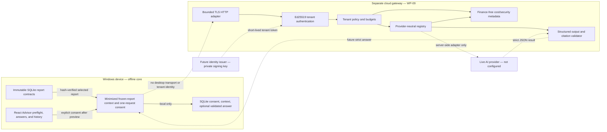

# Cloud Gateway Data Flow

Status: WP-10 local consent/context/answer boundary implemented; live data flow disabled.

Only public-key verification material enters the gateway authentication
component. A provider credential must stay inside a future server-side secret
boundary and is never part of the desktop request, UI, bundle, or repository.

Metering receives identifiers, attempts, units, integer cost, status, and time.
It does not receive the question, selected context, source IDs, or answer. The
reference static policy store and in-memory meter demonstrate this separation;
production persistence remains a release gate.
